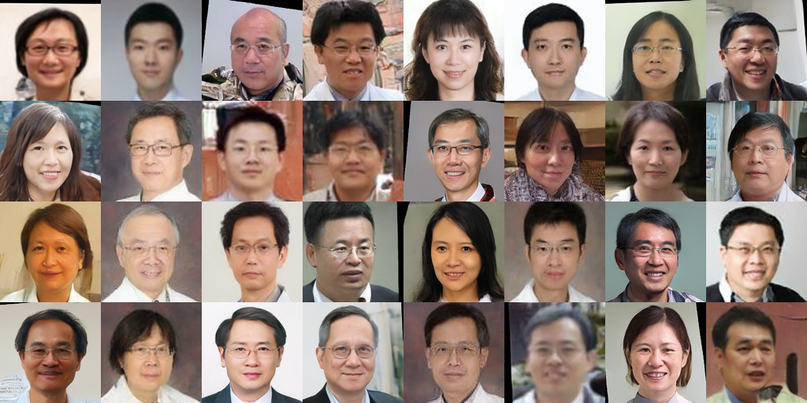

# Generative AI — Coursework Projects

Hands-on projects from the **Generative Artificial Intelligence** course (NYCU, Spring 2026), covering LLM fine-tuning, retrieval-augmented generation, web data collection, and diffusion-based image generation. Each folder is a self-contained project with its own code, README, and results.

**Author:** Yu-Ren Jou (周宥任) — Dept. of Electronics and Electrical Engineering, National Yang Ming Chiao Tung University

| # | Project | Key techniques | Result |
|---|---------|----------------|--------|
| 1 | [Medical Multiple-Choice QA](hw1-medical-qa-lora/) | Llama-3.2-1B-Instruct, LoRA fine-tuning, TF-IDF few-shot retrieval, CoT prompting | **80.7%** test accuracy |
| 2 | [RAG Document QA](hw2-rag-document-qa/) | Sentence-window chunking, HyDE, BM25 + BGE dense hybrid retrieval (RRF), cross-encoder reranking, Llama-3.2-3B via Ollama | Per-paper QA with evidence retrieval |
| 3 | [Hallucination Type Classification](hw3-hallucination-classifier/) | PDF parsing (PyMuPDF), BM25 + BGE retrieval + reranker, QLoRA on Qwen2.5-3B (Unsloth), class oversampling | 5-class Macro-F1 classifier |
| 4 | [PTT Stock Board Crawler](hw4-ptt-stock-crawler/) | `httpx` keep-alive, `lxml` XPath parsing, thread-pool concurrency, profiling | IoU **1.00 / 1.00 / 1.00 / 0.99** on 4 tasks; full-year crawl (28.5k posts) in 28 s |
| 5 | [Latent Diffusion Face Generation](hw5-latent-diffusion-faces/) | Latent DDPM trained from scratch on SD-VAE latents, data augmentation, EMA | **FID 9.84** (256×256) |
| 6 | [Text-Conditional Diffusion from Scratch](hw6-text-conditional-diffusion/) | Hand-written EDM UNet (27.8M params), Heun sampler, classifier-free guidance, CLIP text conditioning | **FID 44.27**, CLIP-T 0.272 (64×64) |

## Sample outputs

| HW5 — unconditional faces (256×256) | HW6 — "a {animal} and a {object}" (64×64) |
|---|---|
|  |  |

## Repository notes

- **Model weights are not included** (LoRA adapters, diffusion checkpoints are 45 MB – 1 GB, beyond GitHub's file limit). Each project's README explains how to retrain; HW5 links to its weights on Google Drive.
- **Course datasets are not redistributed.** Place the provided data in the paths described in each README.
- Code was originally submitted under the file name `{student_id}.py`; files were renamed here for readability.

## Tech stack

Python · PyTorch · Hugging Face Transformers / PEFT · Unsloth · bitsandbytes · sentence-transformers · rank_bm25 · Ollama · diffusers (VAE only) · open_clip · httpx · lxml
