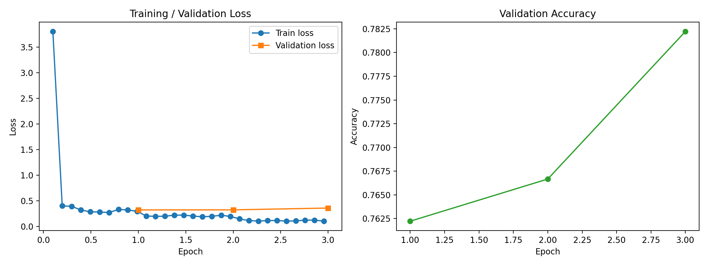
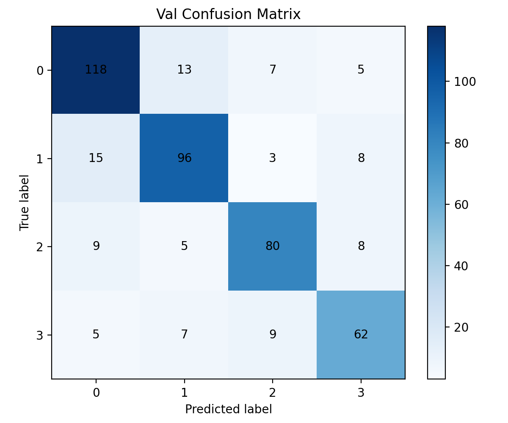
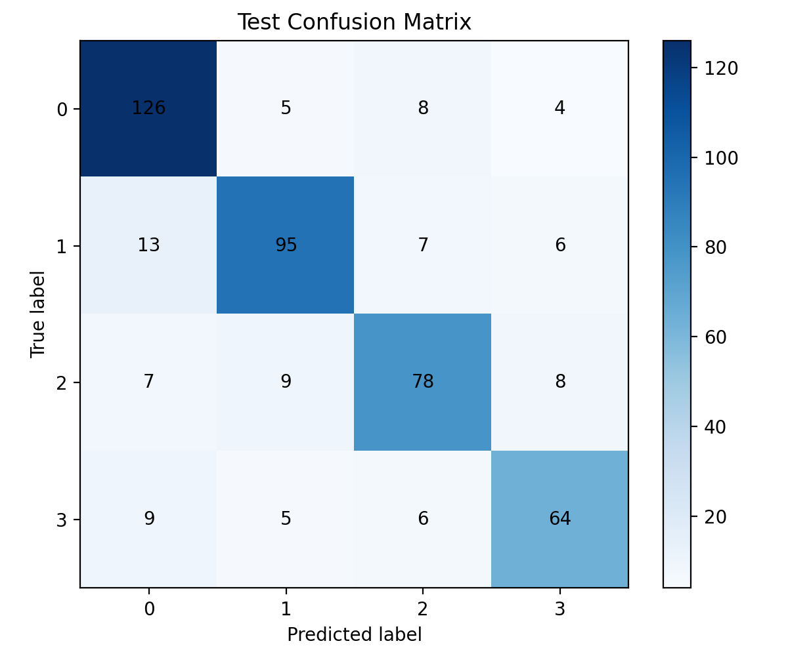

# Medical Question Answering with Llama-3.2-1B-Instruct

## Assignment

Answer pathology multiple-choice questions (4 options, label 0–3) using **only** `meta-llama/Llama-3.2-1B-Instruct` as the base model. Students may use prompting strategies and parameter-efficient fine-tuning; predictions on a hidden benchmark set are graded by accuracy.

> Summarized from the course assignment spec (NYCU Generative AI, Spring 2026). The original spec PDFs are not redistributed.


## 1. Introduction

This project implements a medical pathology multiple-choice question answering system based on the PathoQA dataset. The task is to predict the correct label from `{0, 1, 2, 3}` for each question.

The required base model is:

- `meta-llama/Llama-3.2-1B-Instruct`

To improve performance, this project combines:

- **Few-shot prompting**
- **Chain-of-Thought style reasoning**
- **LoRA finetuning**

---

## 2. Objective

The goal of this homework is to build a pipeline that can:

1. process pathology multiple-choice questions,
2. construct prompting examples from training data,
3. finetune the required model with LoRA,
4. evaluate performance on validation and test sets,
5. generate predictions for the benchmark set.

---

## 3. Method

### 3.1 Base Model

This project uses:

- `meta-llama/Llama-3.2-1B-Instruct`

### 3.2 Prompting Strategy

The model uses a **Few-shot + Chain-of-Thought style** prompting strategy.

For each target question, several similar training examples are retrieved and converted into solved examples containing:

- question
- options
- short rationale
- final answer label

These examples are prepended to the target question, and the model is asked to output only one label from `{0, 1, 2, 3}`.

### 3.3 Retrieval

Few-shot examples are selected using **TF-IDF retrieval**.

- Input fields: question + four options
- Vectorizer: `TfidfVectorizer`
- Analyzer: `char_wb`
- N-gram range: `(3, 5)`

To improve diversity, the retriever prefers examples with different answer labels.

### 3.4 Rationale Construction

The rationale in each solved example is generated by simple rule-based templates.  
It summarizes why the correct option matches the pathology clue in the question.

### 3.5 Finetuning

The project uses **LoRA** for parameter-efficient finetuning.

Target modules:

- `q_proj`
- `k_proj`
- `v_proj`
- `o_proj`
- `gate_proj`
- `up_proj`
- `down_proj`

Default settings:

- `r = 16`
- `lora_alpha = 64`
- `lora_dropout = 0.1`

---

## 4. Dataset and Split

Required files:

- `dataset/dataset.csv`
- `dataset/benchmark.csv`

### Dataset columns

`dataset.csv`:
- `question_id`
- `question`
- `opa`
- `opb`
- `opc`
- `opd`
- `ans`

`benchmark.csv`:
- `question_id`
- `question`
- `opa`
- `opb`
- `opc`
- `opd`

### Split ratio

- train: `90%`
- validation: `5%`
- test: `5%`

The split is stratified by answer label.

Generated files:

- `dataset/train.csv`
- `dataset/val.csv`
- `dataset/test.csv`

---

## 5. Training Setup

Default hyperparameters:

- `num_epochs = 3`
- `learning_rate = 5e-5`
- `weight_decay = 0.05`
- `warmup_ratio = 0.06`
- `train_batch_size = 2`
- `eval_batch_size = 2`
- `gradient_accumulation_steps = 16`
- `max_length = 1024`
- `few_shot_k = 3`
- `few_shot_pool_size = 24`
- `seed = 42`

---


## 6. Project Structure

```text
HW1_112511086/
├── dataset/
│   ├── dataset.csv
│   ├── benchmark.csv
│   ├── train.csv
│   ├── val.csv
│   └── test.csv
├── saved_models/
│   └── <run_name>/
│       ├── metrics.json
│       ├── predictions/
│       └── artifacts/
├── main.py
├── README.md
└── requirements.txt
```

## 7. Usage

### Train

```bash
python main.py train \
  --data-path dataset/dataset.csv \
  --benchmark-path dataset/benchmark.csv \
  --model-name meta-llama/Llama-3.2-1B-Instruct \
  --predict-benchmark
```
### Predict

```bash
python main.py predict \
  --data-path dataset/dataset.csv \
  --benchmark-path dataset/benchmark.csv \
  --model-name meta-llama/Llama-3.2-1B-Instruct \
  --checkpoint-dir saved_models/<run_name>

## 8. Results

| Split | Accuracy |
|---|---:|
| Validation | 79.1% |
| Test | **80.7%** |



| Validation | Test |
|---|---|
|  |  |

Full metrics: [`results/metrics.json`](results/metrics.json) · run config: [`results/run_config.json`](results/run_config.json)

> **Note:** The dataset and the LoRA adapter weights (~45 MB) are not included in this repository. Place the course-provided `dataset.csv` / `benchmark.csv` under `dataset/` and run the training command above.
