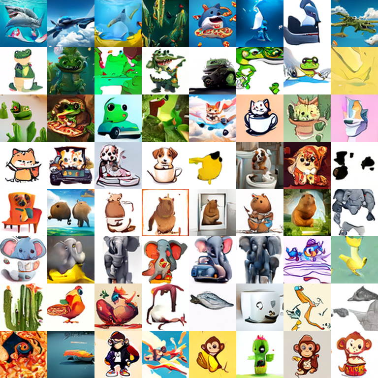

# HW6 — Brainrot Conditional Image Generation (64×64)

## Assignment

Train a **text-conditional** generator from scratch for 64×64 "brainrot" images (an animal + an object, e.g. *a shark and a sneaker*; 10 animals × 10 objects) and generate 2,000 images for given prompts. Graded by FID (image quality) and CLIP-T score (text–image alignment) against baseline thresholds.

> Summarized from the course assignment spec (NYCU Generative AI, Spring 2026). The original spec PDFs are not redistributed.


From-scratch conditional diffusion model that generates 64×64 "brainrot"
(animal + object) images. Trained from random initialization — **no pretrained
generative weights**. Pretrained CLIP is used only as an auxiliary text-feature
extractor for conditioning (permitted by the assignment); a pretrained Inception
is used only for local FID evaluation.

## Results (local scorer = leaderboard-parity)

| Metric | Value | baseline4 target | Status |
|--------|-------|------------------|--------|
| FID    | **44.27** | ≤ 49.2545 | PASS |
| CLIP-T | **0.2720** | ≥ 0.2703  | PASS |

2000 images, guidance 4.0, no CLIP-selection (clean). Scored with the official
`test_mu.npy`/`test_sigma.npy` via the canonical pytorch-fid InceptionV3, and
open_clip `ViT-B-32-quickgelu` for CLIP-T.



## Method

- **Model**: hand-written ADM/EDM-style UNet, ~27.8M params
  (`base=64, ch_mult=(1,2,4,4), num_res_blocks=2`, self-attention at 16²/8²),
  wrapped in EDM preconditioning (Karras et al. 2022). No diffusers, no
  pretrained weights. See `scripts/model.py`.
- **Conditioning**: learned animal & object class embeddings + the pooled CLIP
  text embedding of `"a {animal} and a {object}"`, injected via AdaGN. CLIP text
  features are precomputed once and cached (`scripts/clip_cond.py`); CLIP is
  never part of the training graph.
- **Diffusion**: EDM loss + Karras/Heun deterministic sampler + classifier-free
  guidance, all hand-written (`scripts/diffusion.py`).
- **Training**: EMA (0.9999 with warmup ramp), bf16, CFG-dropout 0.1,
  class-balanced sampling, horizontal-flip augmentation (`scripts/train.py`).

## Environment

- Python 3.11, single NVIDIA GPU (trained on RTX 4080 SUPER 16GB), ~32GB RAM.
- Install:

```bash
pip install -r requirements.txt
# torch/torchvision are CUDA builds; if needed, install the matching wheel:
# pip install torch==2.10.0 torchvision==0.25.0 --index-url https://download.pytorch.org/whl/cu126
```

## Data layout (expected)

```
data/
├── train.csv          # id,animal,object
├── generate.csv       # id,animal,object,prompt  (2000 generation targets)
└── trainset/          # 4,799 training PNGs (64×64)
scoring_program/input/ref/test_mu.npy, test_sigma.npy   # official FID stats (eval only)
```

## Reproduce

All commands run from the project root with the environment above.

### 1. (Optional) Train from scratch — ~2.5h on RTX 4080 SUPER

```bash
python scripts/train.py --preset v1 --batch 96
```

Produces checkpoints in `outputs/run_v1_64b1244/` (`best.pt`, `last.pt`).
`best.pt` (it=30000) is the weights shipped as `model.pth`. The run can be
resumed if interrupted:

```bash
python scripts/train.py --preset v1 --batch 96 --resume outputs/run_v1_64b1244/last.pt
```

### 2. Generate the 2000 submission images

```bash
python scripts/generate.py --ckpt model.pth --out generated_images \
    --steps 30 --guidance 4.0 --oversample 1 --seed 0
```

Writes 2000 PNGs named exactly per `data/generate.csv` into `generated_images/`.
Uses the EMA weights stored in the checkpoint and the hand-written Heun sampler
with classifier-free guidance 4.0.

### 3. (Optional) Score locally

```bash
python scripts/eval_local.py --images_dir generated_images \
    --labels_csv data/generate.csv --expect 2000
```

> Note: the provided `scoring_program/score.py` computes FID with torchvision's
> `inception_v3`, but the official `test_mu/test_sigma` were produced with the
> standard **pytorch-fid** InceptionV3 (verified: real images score ~24 with
> pytorch-fid vs ~333 with torchvision). `scripts/eval_local.py` uses the correct
> pytorch-fid Inception so its FID matches the leaderboard.

## Files

```
scripts/
├── model.py        # from-scratch EDM UNet (+ EDM preconditioning)
├── diffusion.py    # EDM loss + Karras/Heun sampler + CFG
├── train.py        # training loop (EMA, bf16, CFG-dropout, class-balanced)
├── generate.py     # produce the 2000 submission images
├── clip_cond.py    # cache frozen CLIP text features for conditioning
├── dataset.py      # Brainrot dataset + label vocab
├── eval_local.py   # leaderboard-parity FID (pytorch-fid) + CLIP-T
├── sweep.py        # CFG-guidance sweep utility
└── ...             # sanity / diagnostic scripts
model.pth           # trained weights (it=30000) used for generation
requirements.txt
```

## Compliance

- Generative model trained from scratch; no pretrained UNet/Transformer/Diffusion/
  GAN weights (verified — `model.py` loads no pretrained weights).
- Architecture, noise schedule, EDM loss, training loop and sampler are all
  hand-written; no diffusers high-level pipeline.
- Pretrained CLIP is used only for conditioning features and evaluation;
  pretrained Inception only for FID. Neither replaces nor generates the final
  images — every pixel is produced by the trained UNet.
- No external data used (Brainrot trainset only).


## Repository Note

`model.pth` (~445 MB), the cached CLIP features, the 2000 generated images, and the training set are not included. `results/samples_grid.png` shows 64 samples spread across all prompts. Train with step 1 to reproduce the checkpoint.
